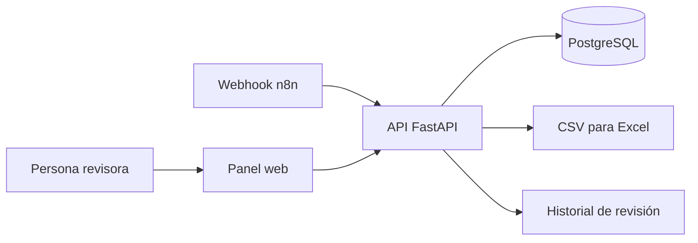

# InvoiceFlow: automatización de facturas con revisión humana

## Resumen

InvoiceFlow demuestra cómo automatizar la recepción y validación de facturas de proveedor sin perder trazabilidad ni la opción de revisión humana.

## Problema

Copiar datos de facturas entre correo, hojas de cálculo y sistemas internos crea tareas repetitivas y dificulta detectar errores, duplicados y estados pendientes.

## Solución

- Un webhook de n8n recibe la factura y llama a una API en Python.
- La API valida campos y totales, detecta duplicados y persiste cada registro en PostgreSQL.
- Las claves de idempotencia evitan crear otro registro cuando se reintenta la misma petición.
- Un panel permite revisar, aprobar o rechazar incidencias y conservar una nota de decisión.
- Un historial de auditoría y una exportación CSV facilitan la revisión posterior.

## Arquitectura

## Tecnologías demostradas

Python, FastAPI, SQLAlchemy, PostgreSQL, Alembic, n8n, Docker Compose, HTML, CSS, JavaScript y CSV/Excel.

## Resultados

Completa esta sección después de ejecutar la demo. Mide varias veces un conjunto fijo de facturas y explica qué incluye cada medición. No presentes estimaciones como resultados observados.

| Medición | Manual | InvoiceFlow | Resultado observado |
|---|---:|---:|---:|
| Tiempo de procesamiento del mismo lote (segundos) | Pendiente de medir | Pendiente de medir | Pendiente de medir |
| Incidencias detectadas en un lote con casos conocidos | Pendiente de medir | Pendiente de medir | Pendiente de medir |

Para calcular el ahorro de tiempo: `(tiempo manual - tiempo InvoiceFlow) / tiempo manual × 100`.

## Alcance y límites de la demo

Los documentos y proveedores son ficticios. El flujo no procesa PDF ni extrae texto mediante OCR. El panel no autentica usuarios; el nombre de quien revisa es un dato escrito manualmente. La demo no se conecta a un sistema contable real.

## Cómo reproducirla

Consulta [la guía de demo](demo-walkthrough.md) para iniciar los servicios y recorrer los casos válido, idempotente y pendiente de revisión.
